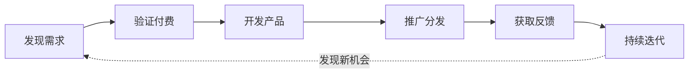

# 嗨，我是侯同学呀 👋

**Hou · AI × Business × Building**

**Research · Build · Grow**

我是一名拥有 **8 年互联网广告投放与商业增长经验** 的互联网从业者。

现在，我正在尝试借助 AI 发现真实需求、开发产品，并探索如何将产品变成一门可持续的生意。

这里记录我的产品、研究、商业实验，以及过程中真实的经验和教训。

**研究生意，创造产品，实践增长。**

[个人网站](https://aibeep.cn) · [产品与项目](https://aibeep.cn/products/) · [X / Twitter](https://x.com/LaohouGrowth) · [全部仓库](https://github.com/2224878257-pixel?tab=repositories)

微信公众号：**侯同学呀**

---

## 正在做的事情

### Research｜研究

研究真实需求、商业模式、市场机会和产品背后的赚钱逻辑。

### Build｜创造

利用 AI 开发软件、网站、实用工具和自动化工作流，尝试解决真实的用户问题。

### Grow｜增长

结合过去 8 年的增长经验，探索产品分发、用户获取、商业变现与可持续增长。

---

## 产品与项目

### 已上线

#### [侯同学呀 · 个人网站](https://aibeep.cn)

我的个人商业实验室，集中展示产品、研究、内容与商业实验。

**状态：** 持续更新 · [访问产品](https://aibeep.cn) · [GitHub](https://github.com/2224878257-pixel/hou-website)

#### [Hou English](https://2224878257-pixel.github.io/hou-english/)

为自己的英语学习设计的网页工具，按照“听、理解、跟读、回忆”完成每日练习。

**状态：** 已上线 · [开始使用](https://2224878257-pixel.github.io/hou-english/) · [GitHub](https://github.com/2224878257-pixel/hou-english)

### 正在开发

#### [念念](https://github.com/2224878257-pixel/niannian-releases)

一个极简、离线优先的 Windows 灵感记录工具，通过全局快捷键快速记录想法。

**状态：** Beta 发布准备中 · [查看项目](https://github.com/2224878257-pixel/niannian-releases) · 下载将在公开 Release 后开放

### 商业研究与实验

#### [造一门生意：从想法到第一笔收入](https://aibeep.cn/products/build-a-business/)

围绕选择方向、验证需求和获得第一笔收入整理的原创电子书。

**状态：** 已上线，可免费下载 PDF / EPUB · [查看与下载](https://aibeep.cn/products/build-a-business/)

#### [需求验证记录表](https://aibeep.cn/products/demand-validation/)

记录需求来源、客户问题、曝光、咨询、订单、成本和复盘的 CSV 模板。

**状态：** 已上线，可免费下载 · [查看与下载](https://aibeep.cn/products/demand-validation/)

---

## 我的实践方法

---

## Skills 与自动化

下面这些成果已经完成实际制作和测试；适合公开的实现会在整理好示例、使用说明与隐私边界后逐步发布。

### 商业研究

- **商业项目深度研究 Skill**：把“值不值得做”转化为带证据、经济性、风险和停止条件的决策报告
- **竞品分析 Skill**：同时研究直接竞品、替代方案、内部流程和“不行动”

### 产品开发

- **AI 浏览器自动化案例**：覆盖公开页面取证、只读报表下载和内容草稿填写，并保留高风险动作的人工确认

### 广告投放与增长

- **广告投放数据诊断 Skill**：检查 CSV / Excel 数据质量，复算 KPI，定位异常并形成可验证实验

### 信息收集与分析

- **每日 AI 商业选题工作流**：从可靠来源筛选近期事件，去重、评分并生成候选题
- **竞品信息变化监测工作流**：跟踪定价、功能、文档和发布说明，只保留值得行动的变化

### 内容生产与自动化

- **多平台内容制作 Skill**：把同一份研究转成公众号、X 和 B 站内容，并检查事实一致性

---

## 找到我

- 个人网站：[aibeep.cn](https://aibeep.cn)
- GitHub：[@2224878257-pixel](https://github.com/2224878257-pixel)
- X / Twitter：[@LaohouGrowth](https://x.com/LaohouGrowth)
- 微信公众号：**侯同学呀**

如果你也在研究 AI、商业、产品或增长，欢迎通过相关项目的 Issues 交流。
